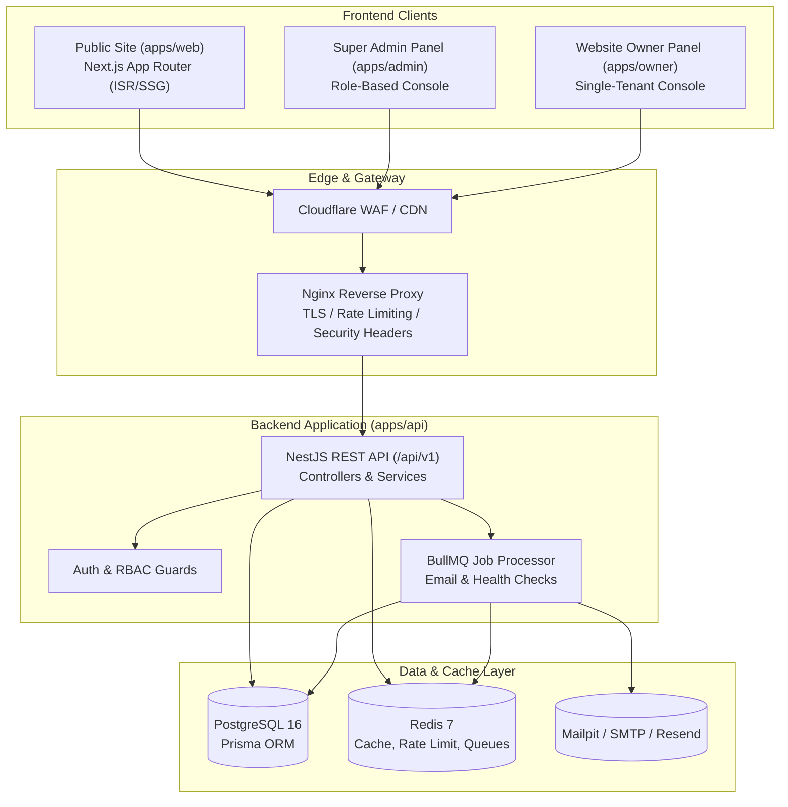

# FindFunLinks — System Architecture Specification

## 1. Monorepo Organization

FindFunLinks uses Turborepo and pnpm workspaces to manage applications and shared packages:

```
findfunlinks/
├── apps/
│   ├── web/             # Public directory website (Next.js App Router, Tailwind, Framer Motion, GSAP)
│   ├── admin/           # Super Admin panel (Next.js App Router, Radix UI / shadcn, TanStack Table)
│   ├── owner/           # Website Owner panel (Next.js App Router, Radix UI / shadcn, TanStack Table)
│   └── api/             # Backend service (NestJS, PostgreSQL, Prisma, Redis, BullMQ)
├── packages/
│   ├── config/          # Shared tsconfig, eslint configs, Tailwind presets, Prettier
│   ├── contracts/       # Single source of truth: Zod schemas, TypeScript types, and enums
│   ├── ui/              # Shared UI design tokens, brand logo assets, common components
│   └── api-client/      # Strongly-typed fetch client generated/built on top of contracts
├── infra/
│   ├── docker/          # Dockerfiles & docker-compose configurations (Postgres, Redis, Mailpit)
│   ├── nginx/           # Reverse proxy, SSL/TLS termination, rate limiting, and security headers
│   └── ci/              # CI/CD pipelines & GitHub Actions definitions
└── docs/                # Architectural, security, and operational documentation
```

---

## 2. High-Level System Architecture



---

## 3. Data & Security Architecture

### 3.1 Authentication & Authorization

- **Argon2id** password hashing.
- **Stateless Access Token (JWT):** 15-minute expiration, containing `userId`, `role`, and essential claims.
- **Rotating Refresh Token:** Stored hashed in PostgreSQL with IP and user-agent metadata; rotated on each use. Reuse detection revokes token families.
- **HttpOnly, Secure, SameSite Cookies:** Protects session tokens from client-side script access.
- **Role-Based Access Control (RBAC):** Hierarchical permissions (`module.action`) with `PermissionsGuard`.
- **Ownership Scope:** Enforces that owners can only inspect or modify their assigned `Website` and its related `Domain` records.

### 3.2 Data Boundaries & Validation

- **Contracts-First:** `packages/contracts` defines Zod validation schemas.
- **Backend Enforcement:** NestJS `ValidationPipe` with `whitelist: true`, `forbidNonWhitelisted: true`, and custom sanitizers.
- **Client-Side Form Validation:** React Hook Form coupled with Zod resolvers.
- **Database Integrity:** Foreign key constraints, unique indexes, and cascading deletes where applicable.

---

## 4. Background Processing & Health Checker

- **BullMQ Workers:**
  1. `mail-queue`: Processes transactional emails (invitations, password resets, report notifications, status alerts) with exponential backoff retries.
  2. `health-check-queue`: Concurrency-controlled, rate-throttled domain health verification.
- **SSRF Hardening:**
  - Performs DNS resolution before making outgoing requests.
  - Rejects all private RFC1918 subnets, loopbacks, link-local, and AWS metadata endpoints.
  - Strict timeout (5s) and redirect limits (max 3).
  - Updates domain status: `ACTIVE`, `DOWN` (after threshold of consecutive failures), `PENDING`, or `BLOCKED`.
