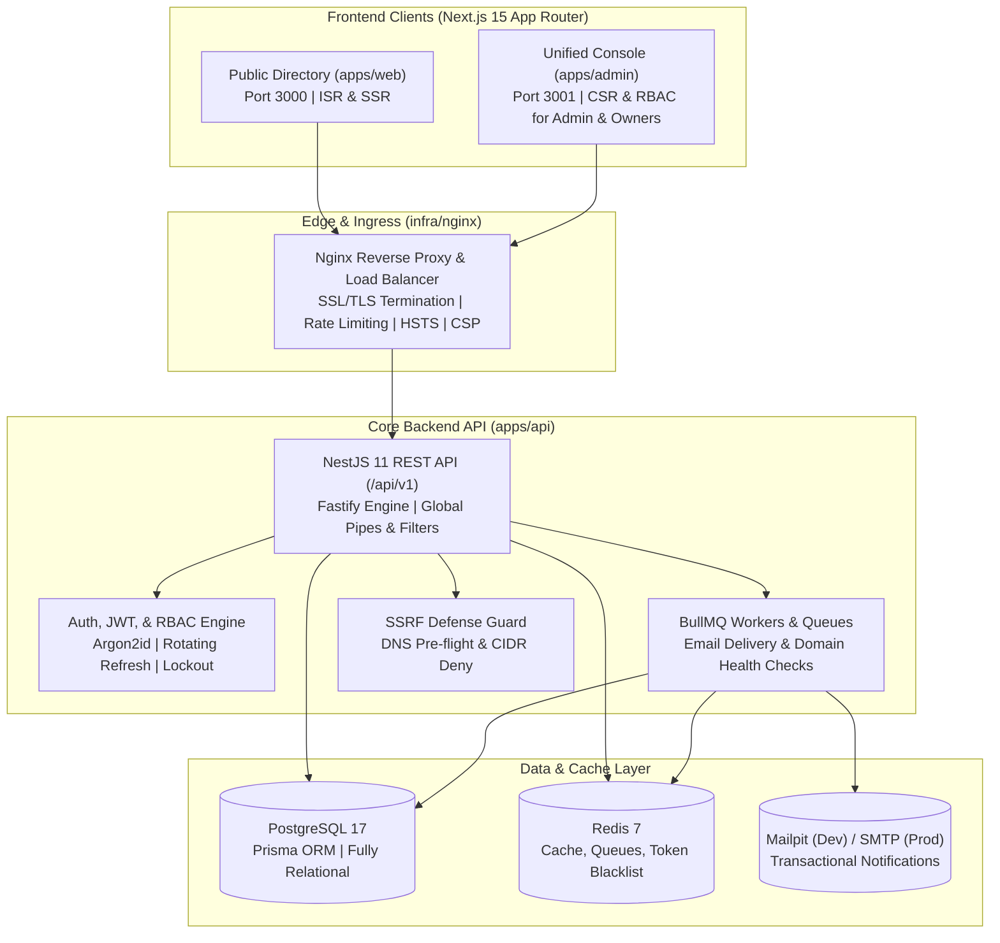
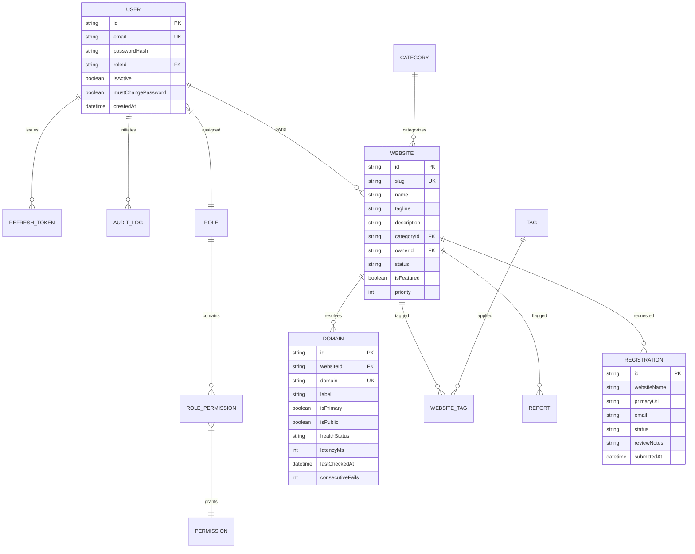
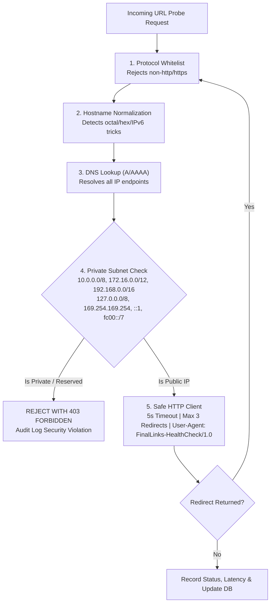

# FinalLinks — System Architecture Specification

## 1. Executive Summary & Monorepo Organization

FinalLinks is an enterprise-grade curated web directory with automated mirror discovery and real-time uptime monitoring. Built as a high-performance monorepo using **Turborepo** and **pnpm workspaces**, it enforces strict architectural boundaries, contract-first API design, and multi-layered defense-in-depth security.

```
finallinks/
├── apps/
│   ├── web/             # Public directory website (Next.js 15 App Router, Tailwind CSS, Framer Motion, GSAP)
│   ├── admin/           # Unified Management & Owner Console (Next.js 15, Radix UI, TanStack Table, RBAC)
│   └── api/             # Backend REST service (NestJS 11, Fastify, PostgreSQL 17, Prisma ORM, Redis 7, BullMQ)
├── packages/
│   ├── config/          # Shared ESLint, Prettier, TypeScript, and Tailwind configurations
│   ├── contracts/       # Single source of truth: Zod schemas, TypeScript types, DTOs, and RBAC enums
│   ├── ui/              # Shared UI design tokens, brand SVG logos, Status badges, and BaseButton primitives
│   └── api-client/      # Type-safe isomorphic HTTP client generated on top of @finallinks/contracts
├── infra/
│   ├── docker/          # Local development backing services (PostgreSQL 17, Redis 7, Mailpit)
│   ├── nginx/           # Production reverse proxy, SSL/TLS termination, rate limiting, and security headers
│   └── ci/              # CI/CD pipeline documentation and automation specifications
└── docs/                # Comprehensive architectural, security, operational, and ADR documentation
```

---

## 2. High-Level System Topology



---

## 3. Core Domain Entities & Relational Data Model

The PostgreSQL schema is managed via Prisma ORM and enforces strict relational integrity:



---

## 4. Mirror Discovery & Fallback Resolution Model

FinalLinks solves link rot and regional ISP blocks by maintaining an active mirror mesh for each curated website:

1. **Hierarchy & Priority:**
   - Each `Website` maintains a collection of `Domain` records.
   - Exactly one domain is designated as `isPrimary: true`. Alternate mirrors have priority indices (0, 1, 2...).
2. **Automated Health Probes:**
   - Scheduled background workers probe all registered domains every 5 to 15 minutes.
   - Domains are probed with strict SSRF-safe HTTP `GET` requests (5-second timeout, maximum 3 redirects).
   - Dynamic status transitions:
     - `ACTIVE` (HTTP 200–399, latency recorded).
     - `WARNING` (High latency > 3000ms or 1–2 consecutive probe failures).
     - `DOWN` (3+ consecutive probe failures).
     - `BLOCKED` (DNS resolution failures or protocol violations).
3. **Client-Side Mirror Popover:**
   - When a user interacts with a website card in `apps/web`, the UI displays a live Mirror Selector popover listing all online mirrors sorted by lowest latency.
   - If the primary domain goes down, the directory dynamically promotes the healthiest mirror with a verified fallback badge.

---

## 5. Multi-Layer SSRF Defense Architecture

To protect internal infrastructure when probing external domains submitted by anonymous users or website owners, the health checker employs defense-in-depth:



---

## 6. Frontend Client Architectures

1. **Public Directory (`apps/web`):**
   - Built on Next.js 15 App Router.
   - Incremental Static Regeneration (ISR) and Server-Side Rendering (SSR) for search engines.
   - Hero animations powered by Framer Motion and GSAP.
   - Responsive category filter tabs, interactive search with debounce, and live mirror status indicators.
2. **Super Admin Console (`apps/admin`):**
   - Full moderation and pipeline review suite.
   - Registration approval pipeline (Approve, Reject with reasons, Request Changes).
   - Domain inspector with on-demand manual health check execution.
   - Audit log viewer with JSON state diff modal.
   - Role-Based Access Control (Super Admin vs Moderator vs Auditor).
3. **Website Owner Portal (`apps/owner`):**
   - Single-tenant ownership scope: authenticated owners can only manage their own website and mirrors.
   - Single and bulk mirror registration with immediate validation.
   - Real-time website profile editor with instant side-by-side card preview.
   - Account settings and forced password change workflow.
